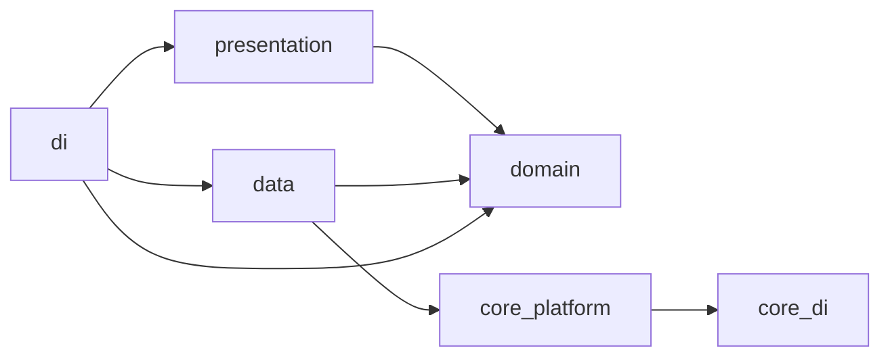

# Plan dựng codebase `quran_app`

Bản lưu của plan trong Cursor. Checklist theo dõi nằm ở `docs/PROGRESS.md`, lịch sử thay đổi hành vi nằm ở `docs/CHANGELOG.md`.

## Trạng thái

- M0. Scaffold và công cụ: hoàn thành.
- M1. Core, design system, shell: hoàn thành (kiểm tra bằng widget test và smoke test, chưa có golden image test).
- M1.5. Refactor token và design system theo `dev-handoff`: chưa bắt đầu. Bước kế tiếp.
- M2 đến M10: chưa bắt đầu.

Ghi chú: ngày 2026-11-08 plan được tích hợp với `dev-handoff/` (xem mục "Tích hợp với dev-handoff"). Các mốc sau M7 được đánh số lại: M8 Widget, M9 Paywall và ads, M10 Hoàn thiện (trước đây là M8).

## Quyết định đã chốt

- Vị trí: `~/projects/6apps/quran/quran_app`.
- State: `flutter_riverpod ^3.4.3`, dùng `Notifier`/`AsyncNotifier` viết tay. Không dùng `StateProvider` (đã chuyển sang `legacy`).
- Entity và state: `freezed` + `freezed_annotation`. DTO: `json_serializable`.
- DI: provider là container duy nhất. Không dùng static holder hay `.instance` (khác với `AppServicesHolder` của lumen-bible).
- Vị trí: một lần xin quyền GPS "While Using" cho cả giờ cầu nguyện và compass. Bị từ chối thì ước lượng theo múi giờ của máy, hiện dải cảnh báo, vẫn lên lịch thông báo, không hiện trạng thái xanh "Facing the Qibla".
- Không có chọn thành phố. Giờ và múi giờ lấy từ máy qua `Clock` inject được.
- Audio: Adhan là 1 clip WAV tối đa 5 giây mỗi giọng, dùng chung iOS và Android. Làm UI stub trước, nguồn âm thanh thật implement sau qua interface.
- Quran offline-first: bundle `meta.json` + 114 file JSON từ QuranEnc (EN/ID/UR/TR) vào `assets/data/quran/`.
- Trong phạm vi v1: home widget (M8), paywall stub và ads (M9).
- Ngoài phạm vi giai đoạn đầu: Firebase.

## Tích hợp với dev-handoff

Thư mục `dev-handoff/` là tài liệu bàn giao từ prototype (file 01 đến 06 sinh tự động, không sửa tay). Nguyên tắc: handoff thắng ở UI, token và logic giờ salah. Plan này thắng ở kiến trúc, ranh giới native và các điểm cắt giảm đã chốt dưới đây. Khi hai bên lệch nhau mà bảng này không nói, báo lại thay vì tự chọn.

| Chủ đề | Quyết định |
|---|---|
| Chọn thành phố | Không có. Bỏ "Choose a city instead" ở onboarding và danh sách thành phố ở Settings > Location (chỉ đọc). Từ chối quyền thì ước lượng theo múi giờ và hiện dải cảnh báo. |
| Adhan | Clip tối đa 5 giây mỗi giọng, dùng chung iOS và Android. Copy là "Plays a short call to prayer". Adhan đầy đủ, exact alarm và foreground service nằm ngoài v1, giữ interface để thêm sau. |
| Audio Listen (Pray) | Giữ stub qua `RecitationPlayer`. Gắn API audio thật khi có thông tin. |
| Widget | Trong v1 (M8). Chưa có design, dùng ngôn ngữ thị giác của prototype (banner, thẻ ayah). Design chính thức cập nhật sau. |
| Paywall | Trong v1 (M9), làm stub, cấu hình gói và giá sau. Premium chỉ gồm: tắt ads và tắt watermark share. |
| Ads | Trong v1 (M9), xem mục "Quy tắc ads" bên dưới. |
| Reset "đã cầu nguyện" | Reset lúc Fajr, không phải 0h. |
| Banner trạng thái | Port nguyên `getPrayerStatus` của prototype (kind now, still, waiting). Lớp trên map ra 6 trạng thái UI (waiting, now, still, prayed, night, paused). |
| Ngưỡng "Đã tới giờ" | 30 phút. Hằng số mặc định, đưa vào remote config ở M10. |
| Token và design system | Theo `dev-handoff/01-design-tokens`. Refactor ở M1.5, trước M2. |
| Bản dịch Quran | EN `english_saheeh`, ID `indonesian_affairs`, UR `urdu_junagarhi`, TR `turkish_rwwad`. Bỏ VI. Mặc định theo ngôn ngữ máy, không có thì EN. |
| Ngôn ngữ UI | v1 giữ `en`, `vi`, `id`. UR và AR (RTL toàn UI) để sau. Từ bây giờ dùng thuộc tính directional (`EdgeInsetsDirectional`, `AlignmentDirectional`, `start/end`). |
| Tên feature | Giữ tên trong plan. Ánh xạ: `home` của prototype là `prayer_times/presentation`, `ayah` là `daily_ayahs`. |
| Cam kết riêng tư | Giờ cầu nguyện tính trên máy. Không gửi tọa độ lên server của app hay cho SDK quảng cáo. Không bán dữ liệu người dùng. (Thay cho câu "Không dùng SDK data broker" ở handoff mục 4.8.) |

### Quy tắc ads

- Không đặt ads cùng màn hình với bản dịch Quran. Nghĩa là không ads ở Reader, Pray, Ayah of the day, Saved, Share sheet và widget Ayah.
- Không ads khi adhan phát, và không ads trong khoảng 10 phút trước và sau mỗi giờ salah.
- Không ads ở Home, onboarding và Prayer alerts.
- Vị trí cho phép ở v1: mục lục Quran (danh sách Surah và Juz) và Settings.
- Ads mặc định non-personalized. Không đính kèm tọa độ vào ad request. Consent bằng ATT (iOS) và UMP (EU, UK).
- Copy onboarding "Quiet by design. No ads during prayer or reading." giữ nguyên.
- Quy tắc nằm trong domain (`AdEligibility`, hàm thuần dùng giờ cầu nguyện và `Clock`) và có test. Test kiến trúc chặn widget ads ở màn bị cấm.
- Điều khoản gốc của QuranEnc (`05-research/content-sources.vi.md`) cần đọc lại trước khi phát hành, để xác nhận cách hiểu "không ads cạnh bản dịch".

## Kiến trúc



- `domain`: Dart thuần (entity freezed, repository interface, use case). Không import Flutter, Riverpod, Dio, drift.
- `data`: datasource, DTO, mapper, repository impl.
- `presentation`: notifier, screen, widget. Chỉ dùng use case hoặc repository interface qua provider.
- `di/` mỗi feature: nơi duy nhất biết lớp impl, trả về interface.
- Feature chỉ phụ thuộc `domain` của feature khác.

```
lib/
  main_dev.dart  main_prod.dart  bootstrap.dart
  app/        app.dart  config/  router/
  core/       di/  error/  network/  storage/  platform/  design_system/  l10n/  utils/
  shared/widgets/
  features/   onboarding  prayer_times  prayer_alerts  pray  quran
              saved_ayahs  daily_ayahs  share  settings  shell
              <feature>/{domain,data,presentation,di}
```

Bootstrap tạo SharedPreferences và AppConfig rồi truyền qua `ProviderScope.overrides`. Mọi thứ chạm platform (location, notification, compass, clock, audio) nằm sau interface trong `core/platform`, test thay bằng fake.

## Cách theo dõi

- Mỗi bước dưới đây là một commit hoặc PR nhỏ. Mỗi mốc kết thúc bằng: `make check` (analyze sạch, test xanh, format đã chạy).
- Tick `docs/PROGRESS.md` sau mỗi bước. Thêm một dòng vào `docs/CHANGELOG.md` mỗi khi đổi hành vi.
- Tài liệu tham chiếu trong lumen-bible (`/Users/hieutt/projects/6apps/bible/lumen-bible`): `CLAUDE.md`, `pubspec.yaml`, `lib/app/config/app_config.dart`, `lib/app/router/app_router.dart`, `lib/core/network/dio_factory.dart`, `lib/core/notifications/notification_service.dart`, `lib/features/share/share_image_exporter.dart`.

## M0. Scaffold và công cụ (hoàn thành)

1. Tạo thư mục, `git init`, `flutter create --org com.sixstudio --project-name quran_app --platforms ios,android`.
2. Thêm dependency chính và dev dependency, chạy `pub get` để kiểm tra tương thích.
3. Flavor dev/prod: Android productFlavors, iOS schemes, `main_dev.dart`, `main_prod.dart`, `AppConfig`, `AppFlavor`.
4. `analysis_options.yaml`, `build.yaml` (freezed, drift, slang, flutter_gen không xung đột), `Makefile` (`analyze`, `test`, `format`, `gen`).
5. Test kiến trúc quét import: domain không import flutter/dio/drift/riverpod, presentation không import data, feature không import data/presentation của feature khác. Test chặn `Color(0x..)` và `EdgeInsets` số thô ngoài `core/design_system`.
6. `CLAUDE.md`, `docs/PROGRESS.md`, `docs/CHANGELOG.md`.

DoD: app chạy được hai flavor, test kiến trúc chạy xanh trên khung rỗng.

## M1. Core, design system, shell (hoàn thành)

1. `core/di/infrastructure_providers.dart`: `appConfigProvider`, `sharedPreferencesProvider` (throw UnimplementedError, override ở bootstrap), `clockProvider`, `dioProvider`. `appDatabaseProvider` dời sang M2 khi có drift.
2. `bootstrap.dart`: khởi tạo prefs, config, `runApp(ProviderScope(overrides: ...))`.
3. `core/error`: `Failure`/`AppException`, kiểu Result đơn giản.
4. Design tokens từ CSS prototype: màu light/dark (brand `#1F5E4E`, accent `#8A6128`/`#D8B26A`, nền `#FBF9F4`), spacing, radius, text style (`ui-*`, `reading-serif-*`, `arabic-*`). `ThemeExtension<AppColors>`, `context.colors`, `AppSpacing`, `AppTextStyles`. Font Onest, Literata, Amiri. Theme mặc định là light.
5. i18n slang: `assets/i18n/{en,vi,id}.json`, base `en`.
6. Shared widgets: button, icon button, large header, nav bar, grouped section và row, switch, segmented, bottom sheet, dialog, toast, tab bar.
7. Router: `StatefulShellRoute.indexedStack` 4 tab (Home, Quran, Ayah of the day, Settings) với màn placeholder, route onboarding và redirect theo cờ onboarding.
8. Test: widget test cho shell và tab bar, smoke test cho hai theme.

DoD: app có 4 tab điều hướng được, đổi light/dark đúng, không hardcode design value.

## M1.5. Refactor token và design system theo dev-handoff

1. Chép token JSON gốc (`03-design/tokens/`) vào `assets/design_tokens/`. Sinh Dart bằng script trong `tool/` (vì `design_value_test` cấm `Color(0x..)` ngoài `core/design_system`).
2. Thay `AppColors` bằng bộ token semantic của `dev-handoff/01-design-tokens` (khoảng 28 token: `background/{default,surface,elevated,overlay}`, `text/*`, `border/*`, `button/*`, `status/*`, `input/*`, `brand/{default,soft}`, `accent/default`). Ngữ nghĩa `background/surface` là nền màn, `background/default` là nền card. Cập nhật mọi widget M1 đang dùng `background` và `surface` cũ.
3. Thêm token cho alias tạm của prototype: `groupBackground`, `toastBackground`, `dialogBackground`, `cardGradient`, `cardText`, `segmentOn`. Thêm token cho màu đang hardcode trong CSS prototype (premium badge, nền share, màu nút dialog hệ thống, họa tiết thẻ).
4. Text style theo handoff (`UI/*`, `reading/serif/*`, `arabic/*`, line height Arabic 190%). Font theo ngôn ngữ bản dịch, trước mắt thêm Noto Nastaliq Urdu (RTL, line height 220%). Kiểm tra Literata hiển thị đúng chữ Thổ Nhĩ Kỳ.
5. Shared widgets bổ sung: button `inverse`, `outline`, `glass`. Icon button `outline`, `glass`. Toast có nút Undo. `LargeHeader` có `trailing`.
6. Spacing dùng `flutter_screenutil` (kích thước theo pt trên màn 393x852). Cập nhật `design_value_test` cho phép `.w`, `.h`, `.sp`. Layout dùng `EdgeInsetsDirectional`.
7. Cập nhật widget và smoke test cho cả hai theme. Chạy `make check`.

DoD: token khớp `01-design-tokens` ở light và dark, test xanh, không hardcode design value.

## M2. Quran (dữ liệu và reader)

1. Tải `meta.json` và 114 file JSON từ QuranEnc (EN `english_saheeh`, ID `indonesian_affairs`, UR `urdu_junagarhi`, TR `turkish_rwwad`) vào `assets/data/quran/` bằng script trong `tool/` (port từ `dev-handoff/04-quran-data`). Ghi nhận version và giấy phép (attribution `title · QuranEnc.com · vX`). Cân nhắc tách file theo ngôn ngữ để không đọc cả bốn bản. Nguồn Arabic duy nhất là trường `arabic_text` của chính QuranEnc (cùng endpoint với bản dịch, được mô tả trong tài liệu API chính thức). Không đối chiếu với nguồn khác. Cấu trúc: tách file theo ngôn ngữ, mỗi surah một file. Test: tổng 6236 ayah, mọi ayah có bản dịch, Arabic khớp `arabic_text` của QuranEnc.
2. Domain freezed: `Surah`, `Ayah`, `AyahRef`, `Juz`, `QuranTranslation`, `TranslatorNote`. Repository interface và use case: `GetSurahList`, `GetSurah`, `GetJuzSections`, `FindJuzOfAyah`, `ParseAyahReference` (`2:255`), `ParseFootnotes`.
3. Data: `AssetQuranDataSource`, DTO json, mapper, `QuranRepositoryImpl`. `quran/di/quran_providers.dart` nối data với domain. Thêm `appDatabaseProvider` (dispose) cho drift.
4. Preferences: ngôn ngữ dịch (EN/ID/UR/TR, mặc định theo ngôn ngữ máy, không có thì EN), cỡ chữ Arabic (small/medium/large), `lastRead`.
5. Màn Quran: tìm theo tên hoặc `2:255`, chuyển Surah/Juz, "Continue reading", danh sách 114 surah và 30 juz.
6. Reader: render lazy theo section, tiêu đề surah, basmala, chọn ayah hiện action bar (Save/Share), mở ghi chú dịch giả, lưu `lastRead`, attribution cuối trang, đọc theo Juz đi qua nhiều surah. Quy tắc hiển thị theo handoff: bỏ chữ "سُورَةُ" ở tên surah, basmala trừ surah 9, chỉ `[số]` là marker footnote. Bản dịch Urdu hiển thị RTL với font Nastaliq.
7. Saved ayahs: drift table, repository, màn Saved, trạng thái tim trong reader.
8. Unit test: các hàm parse, chia Juz, tìm Juz, repository với dữ liệu mẫu.

DoD: đọc được toàn bộ Quran offline, tìm, lưu, tiếp tục đọc, đổi dịch và cỡ chữ.

## M3. Prayer times và Home

1. Domain: `PrayerTimes`, `PrayerWindow`, `PrayerStatus` (sealed: waiting, now, still, prayed, night, paused), `FastingStatus`, `HijriDate`, `CalculationMethod`, `AsrMethod`.
2. Port hàm thuần và test từ `dev-handoff/03-prayer-logic` (`prayer.ts`, `prayer.test.ts`) vào domain: tính cửa sổ (Isha kết thúc ở nửa đêm Hồi giáo), `getPrayerStatus` (now, still, waiting), `getRowState`, nhịn ăn Ramadan, nhãn Hijri đổi ngày lúc Maghrib, điều chỉnh Hijri +/-1 ngày. Lớp trên map sang 6 trạng thái UI. Danh sách "đã cầu nguyện" reset lúc Fajr. Chốt thuật toán Hijri thật (đề xuất Umm al-Qura).
3. `PrayerTimesCalculator` interface và impl bọc package `adhan` (MWL, Umm al-Qura, JAKIM, Hanafi). Phương pháp tính tự chọn theo quốc gia (user đổi được), quy tắc vĩ độ cao. Test giờ khớp lịch chính thức ở Jakarta, Karachi, Cairo, London, New York trong 2 phút.
4. Location: `UserLocation` (source gps/cached/timezone), `LocationPermissionStatus`, `LocationRepository`, use case `ResolveUserLocation` (GPS -> cache -> múi giờ), `RequestLocationPermission`. `core/platform`: `LocationService` (geolocator, accuracy low), `TimeZoneService` (flutter_timezone), `LocationStore`.
5. Asset múi giờ -> tọa độ sinh từ `zone.tab` của IANA bằng script trong `tool/`, xử lý alias cũ, phương án cuối từ UTC offset. Test mọi zone đều tra được.
6. Presentation Home: banner 6 trạng thái, timeline 5 giờ kèm hàng phụ Imsak/Sunrise, nút "I've prayed" có Undo, ngày Gregorian và Hijri. Provider `prayerTimesProvider` watch `userLocationProvider`, `clockProvider`, settings.
7. Dải "Giờ ước tính theo múi giờ" khi nguồn tọa độ là timezone. Nút "Turn on" theo trạng thái: xin quyền, mở Settings của app, mở cài đặt vị trí máy. Chỉ hiện một dải tại một thời điểm (ưu tiên giữa thông báo và vị trí).
8. Tính lại khi app resume, quyền đổi, múi giờ đổi, di chuyển hơn khoảng 10 km (chỉ While Using).
9. Sự kiện: Thứ Sáu (Dhuhr thành Jumu'ah, thẻ Al-Kahf), Ramadan (đếm ngược Iftar/Imsak, thẻ Juz hôm nay), Eid (lời chào).
10. Debug panel chỉ ở flavor dev: override `clockProvider` bằng thanh giờ giả lập để QA các scenario.
11. Test: bảng test state machine với các mốc giờ trong prototype (13:38, 14:58, 15:40, 15:42, 23:10), Friday, Ramadan, Eid, fake `LocationService` cho từng trạng thái quyền.

DoD: Home hiển thị đúng mọi trạng thái, từ chối quyền vẫn có giờ ước tính và dải cảnh báo.

## M4. Onboarding và Prayer alerts

1. Onboarding 3 bước: chào, xin vị trí (nút phụ "Not now", không có "Choose a city instead"), xin thông báo kèm preview 5 giờ. Không paywall. Lưu cờ hoàn thành. Màn chào giữ dòng "Quiet by design. No ads during prayer or reading."
2. `PermissionService` interface (location, notification) và impl.
3. Domain `AlertMode` (adhan/notify/off), `AdhanVoice`, `PrayerAlertSettings`. Repository và use case.
4. `NotificationScheduler` interface và impl (flutter_local_notifications, timezone). Lên lịch theo cửa sổ trượt vài ngày (giới hạn khoảng 64 trên iOS), lên lại mỗi lần mở app và khi vị trí, calculation, alert settings đổi.
5. Màn Prayer alerts: "All five", từng giờ (Adhan/Notify/Off), chọn giọng Adhan, chỉnh +/- phút từng giờ, chuông trên timeline Home dùng chung dữ liệu, "Pause prayer prompts". Thông báo đa loại (salah, nhắc ayah hằng ngày, suhoor và iftar trong Ramadan, Jumu'ah sớm 30 phút tùy chọn), mỗi loại có channel riêng trên Android. Trước khi code phần Android, làm pre-mortem adhan (Q-07).
6. Adhan 5 giây: `AdhanVoiceCatalog` (Makkah, Madinah, Al-Aqsa). Bản gốc `assets/audio/adhan/*.wav` (PCM 16-bit mono 44.1 kHz, tối đa 5.0 giây, fade-out 0.3 giây), script `tool/` copy sang `android/.../res/raw/` và `ios/Runner/`. Android: mỗi giọng một channel có phiên bản (`adhan_makkah_v1`). Chưa có file thì dùng âm thanh mặc định. Sửa copy thành "Plays a short call to prayer".
7. Test: scheduler với fake, logic lên lịch lại, mapping giọng và channel.

DoD: bật thông báo, chọn mode từng giờ, đổi giọng và thông báo được lên lịch lại đúng.

## M5. Pray flow và Qibla

1. `QiblaService` interface (heading từ cảm biến) và impl. Domain tính góc Qibla từ tọa độ.
2. Màn Pray: la bàn kéo/quay, chữ "Turn left/right N°", ngưỡng 5° chuyển xanh bằng `status/success` (không xanh khi tọa độ là ước lượng, thay bằng nhãn "Hướng ước tính" và thẻ bật vị trí). Thêm trạng thái cảm biến: cần hiệu chỉnh, gần kim loại, máy không có cảm biến thì chỉ hiện số độ.
3. Chip 4 surah (1, 112, 113, 114), đọc ayah kèm bản dịch, highlight ayah đang nghe.
4. `RecitationPlayer` interface và bản giả mô phỏng 4 giây mỗi ayah giống prototype. Nút Done đánh dấu đã cầu nguyện và hiện toast Undo.
5. Test: tính góc Qibla với vài tọa độ mẫu, widget test cho trạng thái xanh/ước tính.

DoD: từ Home bấm Pray vào được flow, compass chạy trên máy thật, Done cập nhật Home.

## M6. Daily ayahs và Share

1. Domain `DailyAyahSet`, `DailyAyahSelector` (3 ayah ổn định theo ngày từ danh sách curated, seed theo ngày), trạng thái reveal lưu theo ngày. Nguồn dữ liệu `assets/data/daily_ayahs.json` (danh sách `AyahRef`). Trước mắt dùng danh sách tạm khoảng 30 ayah, danh sách khoảng 300 ayah chờ người review tôn giáo (Q-04).
2. Màn Ayah of the day: 3 thẻ úp, chạm để mở, vuốt để chuyển, thẻ thứ 4 "hẹn ngày mai", chấm tiến trình, Save, Open in Quran, Share.
3. Nhắc ayah hằng ngày sau Fajr hoặc sau Maghrib (cấu hình ở Settings), dùng lại `NotificationScheduler`.
4. Share: sheet với 4 nền (gradient, solid, pattern, night), xuất ảnh 1080x1920 bằng RepaintBoundary (tham khảo lumen), 5 đích chia sẻ, watermark có công tắc Premium (nối `isPremiumProvider` ở M9). Cỡ chữ co theo độ dài ayah, riêng cho Urdu (Nastaliq cao hơn nhiều).
5. Test: selector ổn định theo ngày, reveal reset sang ngày mới, export ảnh smoke test.

DoD: luồng mở 3 thẻ, lưu, mở trong reader và chia sẻ ảnh hoạt động.

## M7. Settings hoàn chỉnh

1. Màn Settings theo nhóm: Prayer times (Location chỉ đọc theo trạng thái, không có danh sách thành phố, Calculation, Asr, Hijri), Notifications (Prayer alerts, Daily ayahs kèm giờ nhắc, Pause), Quran (Translation EN/ID/UR/TR, Arabic size), Appearance (Light/Dark).
2. Màn option picker generic cấu hình bằng data (thay vì 9 màn riêng).
3. Sources and licenses (liệt kê bản dịch QuranEnc kèm version, font, icon), Rate us, Privacy Policy, Terms of Use (link ngoài).
4. Test: mọi thay đổi trong Settings làm đổi Home và Reader đúng.

DoD: mọi mục Settings của prototype có hành vi thật hoặc stub rõ ràng.

## M8. Home widget

1. Chốt khung dữ liệu: `WidgetPublisher` interface trong `core/platform` (fake trong test). Dữ liệu đã tính sẵn (giờ cầu nguyện nhiều ngày, ayah hôm nay) được ghi vào kho dùng chung với native (App Group trên iOS, SharedPreferences trên Android), ghi lại mỗi khi lịch thông báo được lên lại.
2. Widget Next prayer (S, M, lock screen iOS) dựa trên banner Home. Widget Ayah of the day (S, M) dựa trên thẻ ayah. Dùng ngôn ngữ thị giác của prototype, design chính thức cập nhật sau.
3. iOS: WidgetKit extension và App Group. Android: `AppWidgetProvider`.
4. Widget Ayah hiển thị bản dịch nên không có ads.
5. Test: `WidgetPublisher` với fake, dữ liệu publish đổi khi vị trí, cài đặt hoặc ngày đổi. Event `widget_added`.

DoD: thêm được widget trên iOS và Android, nội dung đổi đúng theo giờ cầu nguyện và ngày.

## M9. Paywall và ads

1. `PurchaseService` interface trong `core/platform`, impl RevenueCat, fake trong test. Gói và giá là stub, cấu hình sau. `isPremiumProvider` là nguồn duy nhất.
2. Premium chỉ gồm: tắt ads và tắt watermark share. Màn paywall đơn giản, mở từ dòng watermark ở Share và từ Settings.
3. `AdService` interface, impl AdMob, fake trong test. Chỉ ads non-personalized mặc định, không đính kèm tọa độ. Consent: ATT (iOS) và UMP (EU, UK).
4. `AdEligibility` (domain, hàm thuần): không ads trong khoảng 10 phút quanh giờ salah, không ads khi adhan phát, không ads khi Premium.
5. Vị trí: mục lục Quran và Settings. Test kiến trúc chặn widget ads ở Reader, Pray, Ayah of the day, Saved, Share, Home, onboarding và Prayer alerts.
6. Cập nhật Privacy Policy, App Store Privacy labels và Google Play Data Safety. Cam kết riêng tư theo mục "Tích hợp với dev-handoff".
7. Test: `AdEligibility` với bảng giờ, Premium tắt ads và watermark, màn bị cấm không dựng ads.

DoD: mua Premium (stub) tắt ads và watermark, ads chỉ xuất hiện ở hai màn cho phép và đúng luật thời gian.

## M10. Hoàn thiện

1. Verify dark mode bằng cách switch từng màn, sửa chỗ lệch token. Thêm golden test cho các trạng thái ở bảng màn của handoff, light và dark.
2. Accessibility: nhãn semantics cho compass, ayah, nút icon, cỡ chữ lớn.
3. Offline: kiểm tra mọi màn không trống khi mất mạng, khi không có quyền, khi chưa có cache.
4. Hạ tầng mở rộng qua interface trong `core/`: analytics và remote config (`NOW_WINDOW_MIN`). Event taxonomy theo Q-09. Chưa cắm Firebase.
5. Nghiệm thu theo `dev-handoff` mục 10: mọi trạng thái đúng prototype ở cả hai theme, test port từ `prayer.test.ts` xanh, giờ khớp 5 thành phố trong 2 phút, adhan đúng giờ trên 95% máy test (kể cả sau reboot và đổi múi giờ), Arabic khớp 100% nguồn, không hardcode design value.
6. Rà soát test coverage cho domain, chạy `make check`, cập nhật `docs/CHANGELOG.md`.

## Rủi ro và lưu ý

- Giờ ước tính theo múi giờ có thể lệch vài phút tới vài chục phút ở zone rộng và vĩ độ cao. UI luôn ghi rõ.
- iOS giới hạn âm thanh thông báo (clip ngắn) và số lượng thông báo cục bộ. Thiết kế đã tính (5 giây, cửa sổ trượt).
- Cần xác nhận giấy phép bản dịch QuranEnc (Q-01), audio (Q-02), font Arabic (Q-03) và người review tôn giáo (Q-04) trước khi phát hành. File Adhan và API audio Listen chưa có.
- Bản dịch Urdu (RTL, Nastaliq) cần kiểm tra riêng ở Reader, thẻ ayah, Saved, ảnh share và footnote marker.
- Ads trong app đọc Quran nhạy cảm với người dùng. Luật cứng ở mục "Quy tắc ads" phải có test, không chỉ là quy ước.
- Widget cần design chính thức và phần native Swift, Kotlin nằm ngoài kiến trúc Dart.
- Heading của la bàn có thể cần kiểm tra quyền trên iOS và Android khi làm trên máy thật.
